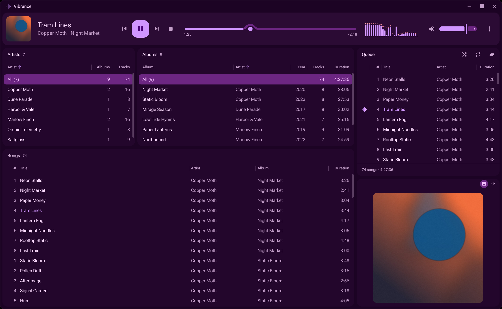

# Vibrance

A fast, native music player for Linux, built with Rust and [iced](https://iced.rs).



## Run

```
sudo dnf install alsa-lib-devel opus-devel mold
cargo run --release -p vibrance
```

`--release` is fully optimized (fat LTO) and slow to build. For day-to-day work, `cargo run --profile fast -p vibrance` rebuilds in seconds and runs nearly as fast.

Import your music with Ctrl+O. `vibrance --help` lists the testing options.

Vibrance adds itself to your app launcher (`~/.local/share/applications`) when it starts, so the taskbar shows its icon.

The campfire visualizer uses photo-scanned assets (CC0, from [Poly Haven](https://polyhaven.com), about 290 MB). Fetch them once with `scripts/fetch-campfire-assets.py`.

## License

MIT. Bundled fonts: Roboto Flex (OFL 1.1) and Material Symbols (Apache 2.0).

The visualizer's warp follows [MilkDrop 2](https://github.com/xbmc/visualization.milkdrop2) (BSD, © Nullsoft) and [Butterchurn](https://github.com/jberg/butterchurn) (MIT, © Jordan Berg). The campfire's fire simulation follows GPU Gems 3 ch. 30 and Nguyen, Fedkiw & Jensen, "Physically Based Modeling and Animation of Fire" (SIGGRAPH 2002); its scene assets are CC0 from Poly Haven.
